# Diseño e impresión 3D

## Introducción

En esta práctica diseñé un fidget toy en Autodesk Fusion y una figura fija de Darth Vader utilizando la IA de MakerLab. La intención fue conocer el proceso desde el diseño hasta la impresión, además de comparar el mismo fidget toy en dos impresoras diferentes.

## Objetivo

Crear una figura con al menos dos piezas móviles y otra diseñada con IA de máximo 5 × 5 cm, documentando el proceso y los resultados de impresión.

## Materiales y herramientas

- Autodesk Fusion.
- MakerLab de MakerWorld.
- Impresora Creality CR-10 SE.
- Impresora Creality Ender-3 V3 KE.
- Filamento: PLA (blanco y rojo).

---

## 1. Diseño del fidget toy

El diseño se realizó en **Autodesk Fusion**, siguiendo este [video tutorial](https://www.youtube.com/watch?v=n7AkvIi4th4&t=35s).

### Bocetos iniciales

Primero dibujé el hexágono de referencia y después el perfil de las piezas. En el perfil utilicé un espesor de **1.2 mm**, una altura de **10 mm** y un ángulo de **130°**.

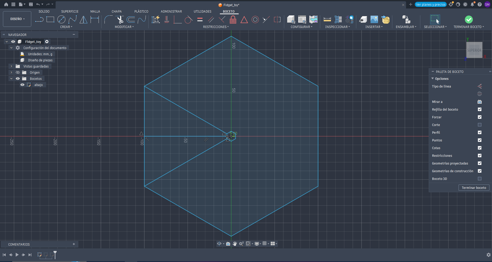

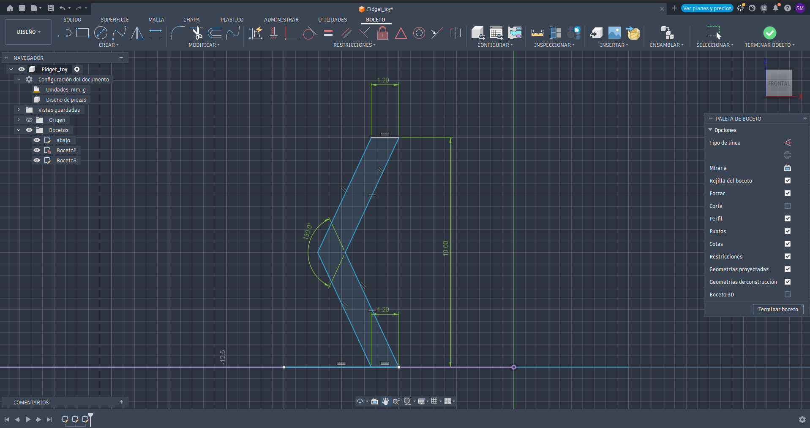

### Extrusión y patrón rectangular

Realicé una extrusión de **50 mm hacia cada lado**. Después apliqué un patrón rectangular de **30 repeticiones**, con un espaciado de **1.2 + 0.6 = 1.8 mm**. Los 0.6 mm corresponden a la separación considerada entre las piezas.

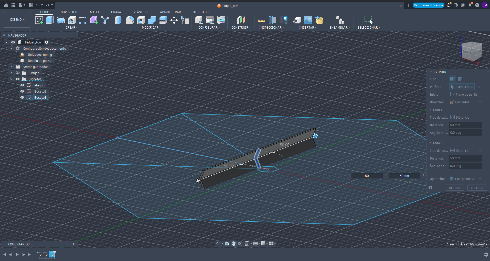

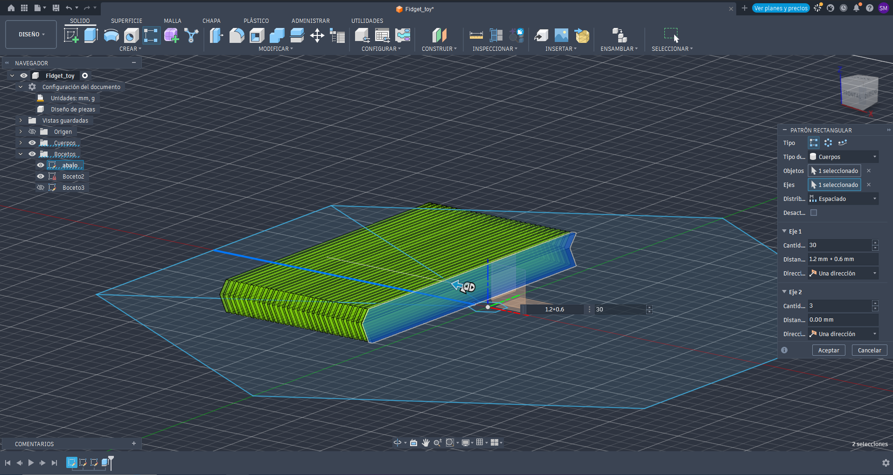

### Corte y patrón circular

Realicé una extrusión inversa con la operación de corte para retirar el material sobrante. Después utilicé un patrón circular de **6 repeticiones alrededor del eje Z**, identificado en azul, para completar el hexágono.

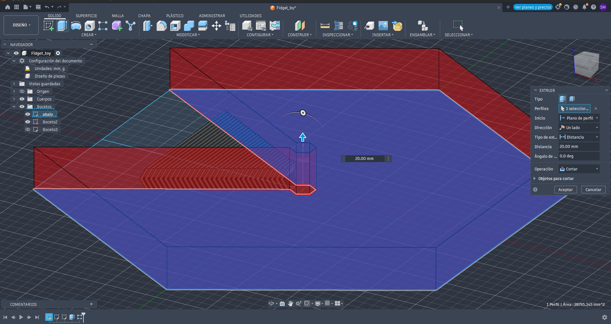

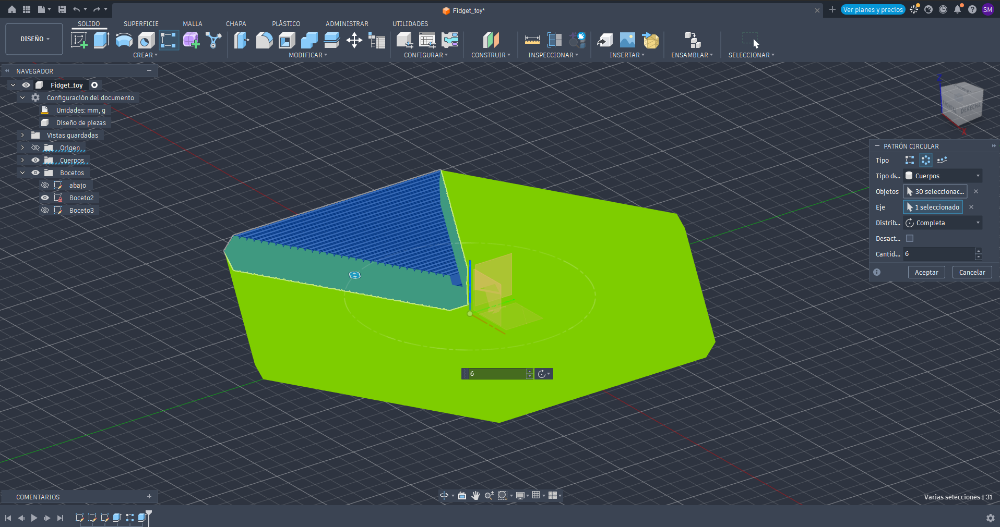

### Diseño terminado

Con estas operaciones obtuve el modelo completo del fidget toy.

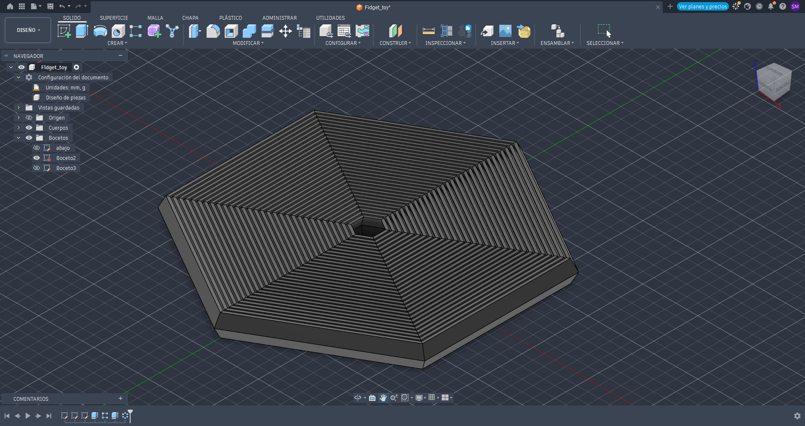

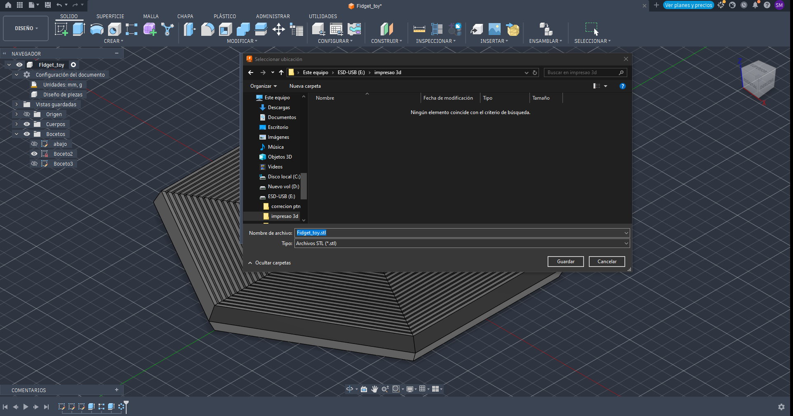

---

## 2. Impresión y comparación del fidget toy

La primera impresión se realizó en una **Creality CR-10 con soportes automáticos**. En la segunda impresión del mismo diseño **no se utilizaron soportes**.

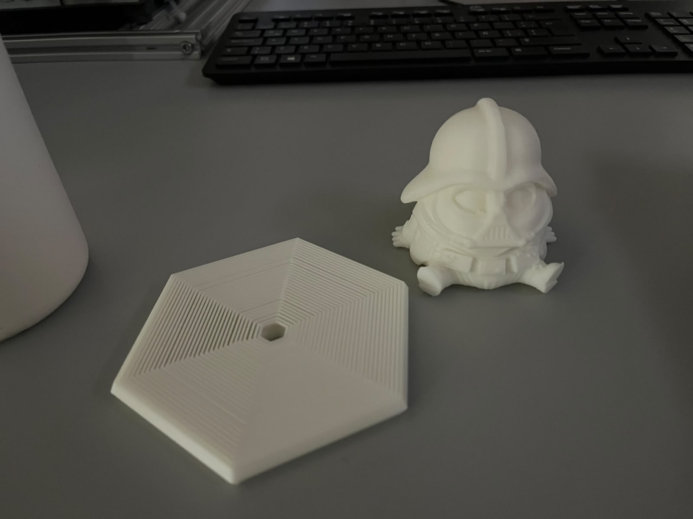

| Característica | Creality CR-10 SE | Creality Ender-3 V3 KE |
|---|---|---|
| Material | PLA (blanco/rojo) | PLA (blanco/rojo) |
| Dimensiones | 5 × 5 cm | 6 x 6 cm|
| Altura de capa | No especificado | No especificado |
| Relleno | 20% | 20% |
| Soportes | Automáticos | Arból |
| Tiempo | 3 - 5 horas  | 3 - 5 horas |
| Acabado y movimiento |  Al no utilizar soportes, no fue necesario retirarlos y se facilitó la revisión del movimiento de las piezas| La pieza necesitó soportes, por lo que fue necesario retirarlos al terminar la impresión 

**¿Cuál fue más rápida?**  
El tiempo de las impresoras fue parecido, no hubo mucha diferencia sin embargo la **Creality Ender-3 V3 KE** fue un poco más rápida.

**¿Cuál tuvo mejor resultado y por qué?**  
La impresión realizada en la **Creality Ender-3 V3 KE** Fue un poco más rápida y eficiente ya que se usaron soportes de arból. Esto también permitió revisar de manera más directa el movimiento de las piezas. En cambio, la impresión realizada en la **Creality CR-10 SE** utilizó soportes automáticos, en los cuales tuve dificultades en removerlos.

---

## 3. Figura fija con IA: Darth Vader

Para esta figura utilicé **MakerLab de MakerWorld**. Cargué una imagen de Darth Vader y la IA generó el modelo 3D, del cual obtuve el archivo STL.

### Imagen de referencia y modelo generado

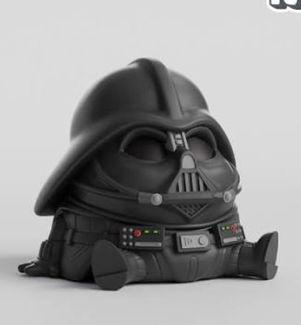

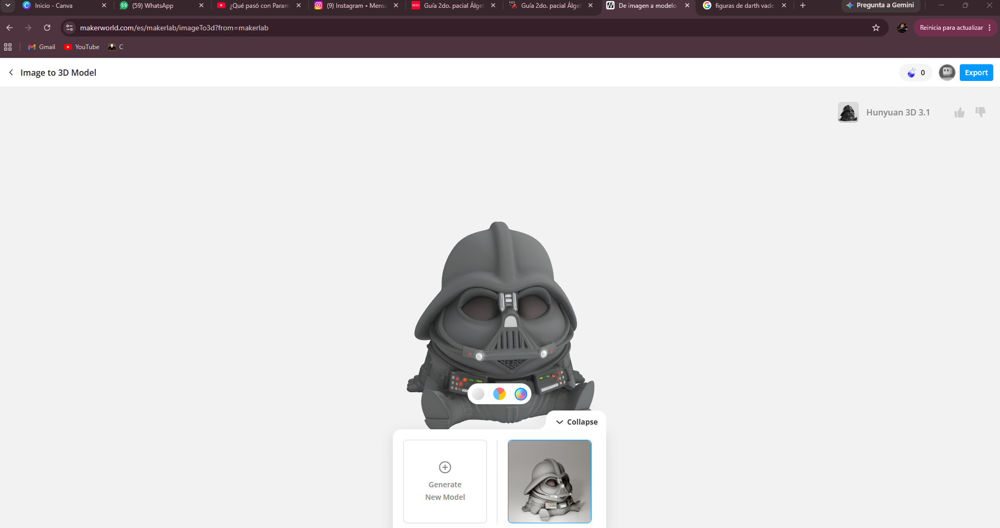

### Preparación e impresión

Preparé el modelo para imprimirlo en una **Creality CR-10 SE**, utilizando **soportes automáticos**. El límite indicado para esta figura fue de **5 × 5 cm**.

| Dato | Información |
|---|---|
| Dimensiones finales | Aproximadamente 5 × 5 × 5 cm |
| Material | PLA blanco |
| Altura de capa | 0.20 mm |
| Relleno | 15 % |
| Soportes | Automáticos |
| Tiempo de impresión | 3 horas |

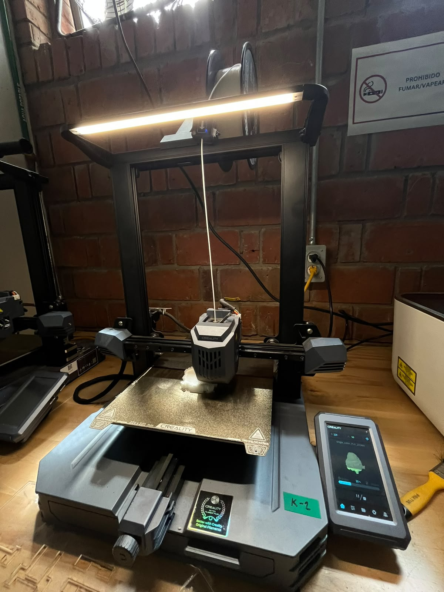

Después de imprimir se retiraron los soportes para revisar el acabado de la figura.

**Observaciones:** [Hubo dificultad al retirar los soportes ya que no se eligio de arból].

---

## 4. Resultados finales

### Fidget toys

### Darth Vader

---

## 5. Videos

- [Impresión en Creality CR-10 SE](assets/videos/07-impresio3d/videocrealitylabdemario.mp4).
- [Movimiento de los fidget toys](assets/videos/07-impresio3d/fidgettoy.mp4).

---

## Conclusión

Esta práctica me ayudó a entender cómo pasar de un diseño digital a una pieza impresa. En Fusion trabajé con bocetos, extrusiones y patrones, mientras que con MakerLab pude generar una figura a partir de una imagen usando IA.

También fue importante considerar la separación entre las piezas móviles y el uso de soportes. La comparación de las impresiones permitió identificar cuál tuvo mejor acabado, menor tiempo y mejor movimiento de las piezas.

## Referencias

- [Tutorial del fidget toy](https://www.youtube.com/watch?v=n7AkvIi4th4&t=35s).
- Autodesk Fusion: software de diseño.
- MakerLab de MakerWorld: generación del modelo con IA.